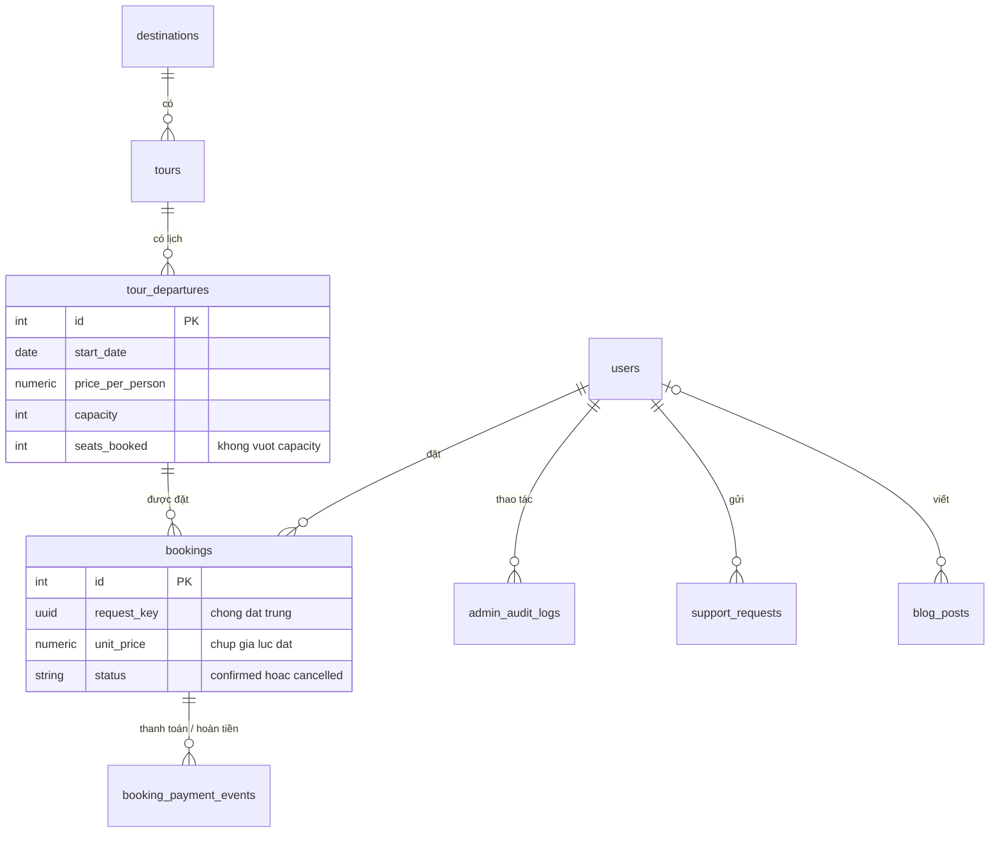

# 🌴 Travel Mint — Website đặt tour du lịch tích hợp AI


Website đặt tour du lịch fullstack: khách xem, lọc và đặt tour; admin quản lý tour, đơn đặt, blog và yêu cầu hỗ trợ; trợ lý AI (Google Gemini) gợi ý tour phù hợp với nhu cầu.

🔗 **Demo:** https://travel.trizportal.com  ·  📘 **Tài liệu API (Swagger):** https://travel.trizportal.com/api-docs


> **English summary:** a full-stack tour booking web app built with React 19, Express 5 and PostgreSQL. Highlights: seat booking that never oversells under concurrent requests (row-level locking), session authentication with bcrypt, CSRF tokens and per-route rate limiting, an admin dashboard, a Markdown blog, and a Google Gemini tour advisor with structured JSON output and an automatic database fallback. Deployed on Vercel with a Neon Postgres database.

---

## ✨ Tính năng

**Khách hàng**
- Xem danh sách tour, lọc theo khu vực, ngân sách, số ngày; xem chi tiết và lịch khởi hành còn chỗ
- Đăng ký, đăng nhập, đặt tour, xem và hủy đơn của mình
- Trợ lý AI tư vấn tour, quiz tìm chuyến đi, so sánh tối đa 3 tour
- Đọc blog du lịch, gửi yêu cầu hỗ trợ
- Giao diện sáng/tối, dùng tốt trên điện thoại

**Quản trị (admin)**
- Dashboard: doanh thu 6 tháng, việc cần xử lý, tour bán chạy
- Quản lý tour và lịch khởi hành, đơn đặt (xác nhận thanh toán, hoàn tiền, xuất CSV), người dùng
- Soạn bài blog bằng Markdown, xử lý yêu cầu hỗ trợ, xem nhật ký thao tác của admin

| | |
|---|---|
|  |  |
| **Trang chủ** | **Giao diện tối** |
|  |  |
| **Blog** viết bằng Markdown | **So sánh** tour cạnh nhau |
|  |  |
| **Trình soạn bài** của admin | **Dashboard** quản trị (dữ liệu mẫu) |

## 🧰 Công nghệ

| Tầng | Công nghệ |
|------|-----------|
| Frontend | React 19, Vite, React Router, Context API, CSS thuần |
| Backend | Node.js 24, Express 5, REST API (11 nhóm route), Swagger/OpenAPI |
| Database | PostgreSQL trên Neon, 10 file migration SQL |
| AI | Google Gemini API |
| Deploy | Vercel: giao diện tĩnh + Express chạy dạng Serverless Function |
| Công cụ | Git/GitHub, ESLint |

## 🧠 Điểm nhấn kỹ thuật

**Không bán quá số chỗ khi nhiều người đặt cùng lúc.** Đặt tour chạy trong một transaction, khóa dòng lịch khởi hành bằng `SELECT ... FOR UPDATE` rồi mới kiểm tra và trừ chỗ; ràng buộc `CHECK (seats_booked <= capacity)` trong database là lớp bảo vệ cuối ([`bookingService.js`](server/src/services/bookingService.js)).

**Bấm hai lần không tạo đơn trùng.** Mỗi lần đặt kèm một `request_key` (UUID); gửi lại cùng mã thì server trả về đơn cũ thay vì tạo đơn mới.

**Không tin dữ liệu từ trình duyệt.** Giá và tổng tiền luôn lấy từ database; quyền `user`/`admin` được đọc lại từ database ở mỗi request.

**Bảo mật**
- Đăng nhập bằng session lưu trong PostgreSQL, mật khẩu băm bằng **bcrypt**, đổi mã phiên sau khi đăng nhập
- **CSRF token** cho mọi request ghi dữ liệu, kèm kiểm tra `Origin`
- **Rate limiting** riêng cho đăng nhập, đăng ký, đặt tour, form hỗ trợ và trợ lý AI
- Header bảo mật (CSP, HSTS, X-Frame-Options...), giới hạn kích thước request
- Blog chống XSS: Markdown được chuyển thành phần tử React, không dùng `dangerouslySetInnerHTML`

**Trợ lý AI** ([`consultationService.js`](server/src/services/consultationService.js))
- Khóa Gemini chỉ nằm ở server; Gemini buộc trả về JSON theo schema (câu trả lời + tối đa 3 tour kèm lý do)
- Chống prompt injection: kiểm tra đầu ra, tour AI chọn phải có trong danh sách đã gửi; giá và số chỗ luôn lấy lại từ database
- Mỗi lần gọi tối đa 10 giây; AI lỗi, quá giờ hoặc chưa có API key thì tự gợi ý tour từ database

## 🗄️ Mô hình dữ liệu



Ngoài ra có bảng `user_sessions` lưu phiên đăng nhập.

## 🗂️ Cấu trúc thư mục

```
travel_AI_booking/
├── api/index.js        # điểm vào của backend trên Vercel
├── vercel.json         # cấu hình build, định tuyến, header bảo mật cho Vercel
├── client/             # Frontend React (Vite)
│   └── src/
│       ├── pages/      # các trang của khách và admin
│       ├── components/ # Header, TourCard, Hero, RevenueChart...
│       ├── services/   # hàm gọi API
│       ├── context/    # đăng nhập, so sánh tour
│       └── styles/     # CSS theo từng khu vực
└── server/             # Backend Express
    ├── sql/            # migration 001 → 010 (tạo bảng + dữ liệu mẫu)
    ├── scripts/        # make-admin.js: cấp quyền admin
    └── src/
        ├── routes/     # 11 nhóm API
        ├── controllers/
        ├── services/   # đặt tour, gợi ý, gọi Gemini
        ├── middleware/ # auth, csrf, security headers
        └── docs/       # tài liệu Swagger
```

## 🚀 Chạy trên máy

**Cần có:** Node.js 24 và PostgreSQL.

```bash
# 1. Tạo database rồi chạy lần lượt các file server/sql/001 → 010 (bằng pgAdmin hoặc psql)

# 2. Backend
cd server
cp .env.example .env    # điền thông tin PostgreSQL và SESSION_SECRET
npm install
npm run dev             # http://localhost:5000  ·  Swagger: http://localhost:5000/api-docs

# 3. Frontend (mở terminal khác)
cd client
npm install
npm run dev             # http://localhost:5173
```

Tạo tài khoản admin: đăng ký trên website, rồi chạy `npm run make-admin -- email-cua-ban@example.com` trong thư mục `server`.

## ☁️ Deploy lên Vercel

1. Chạy các file `server/sql/001 → 010` trên database Neon.
2. Import repo vào Vercel, giữ nguyên *Root Directory*; [`vercel.json`](vercel.json) đã khai báo sẵn cách cài, build và định tuyến.
3. Thêm biến môi trường:

| Biến | Giá trị |
|---|---|
| `DATABASE_URL` | Chuỗi kết nối Neon |
| `SESSION_SECRET` | Chuỗi ngẫu nhiên, ít nhất 32 ký tự |
| `CLIENT_URL` | Địa chỉ website, ví dụ `https://ten-du-an.vercel.app` |
| `NODE_ENV` | `production` |
| `DATABASE_SSL` | `true` |
| `GEMINI_API_KEY` | Không bắt buộc; bỏ trống thì trợ lý dùng gợi ý từ database |

Vercel phục vụ giao diện đã build, còn `/api/*` và `/api-docs` chạy qua app Express trong [`api/index.js`](api/index.js). Giao diện và API cùng một domain nên không cần cấu hình CORS.

## ⚠️ Giới hạn đã biết

- Thanh toán là ghi sổ thủ công: admin xác nhận sau khi kiểm tra chuyển khoản, chưa có cổng thanh toán.
- Chưa gửi email xác nhận đơn.
- Tour, giá và lịch khởi hành là dữ liệu mẫu.
- Chưa có kiểm thử tự động; các luồng chính được kiểm tra thủ công trên trình duyệt.
- Trên Vercel, rate limit đếm riêng trong từng instance nên lỏng hơn khi chạy một server; muốn chặt cần lưu bộ đếm vào Redis.

## 🤝 Đóng góp

Dự án bắt đầu như bài làm nhóm và hiện do mình duy trì.

- **Phùng Khắc Khoan:** ý tưởng và tính năng, thiết kế database và luồng đặt tour, backend (đặt tour, xác thực, bảo mật, thanh toán thủ công, nhật ký admin, trợ lý AI), trang quản trị, blog, so sánh tour, quiz, giao diện sáng/tối và deploy.
- **Nguyễn Tấn Hùng (`hungdz`):** thiết kế lại giao diện đăng nhập/đăng ký, phần hero và trang chi tiết tour, form đặt tour; làm tính năng Liên hệ (bảng `support_requests`, API và trang Liên hệ); viết tài liệu Swagger ban đầu; sửa cấu hình CORS và CSRF cho môi trường local.

**Về việc dùng AI:** mình dùng Claude (Anthropic) làm trợ lý lập trình, ước chừng 60% lượng code được viết cùng AI (code khung, refactor, rà lỗi bảo mật). Mình quyết định cách làm, đọc lại và chỉnh từng thay đổi, chạy thử trên máy và deploy.

## 📄 Giấy phép

Mã nguồn theo giấy phép [MIT](LICENSE). Ảnh điểm đến lấy từ Wikimedia Commons; tác giả và giấy phép từng ảnh được ghi tại trang `/credits` của website.

## 👤 Tác giả

**Phùng Khắc Khoan**, sinh viên Hệ thống Thông tin, Trường ĐH Công nghệ Thông tin (UIT – ĐHQG-HCM) · GitHub: [@khoan2202](https://github.com/khoan2202)
