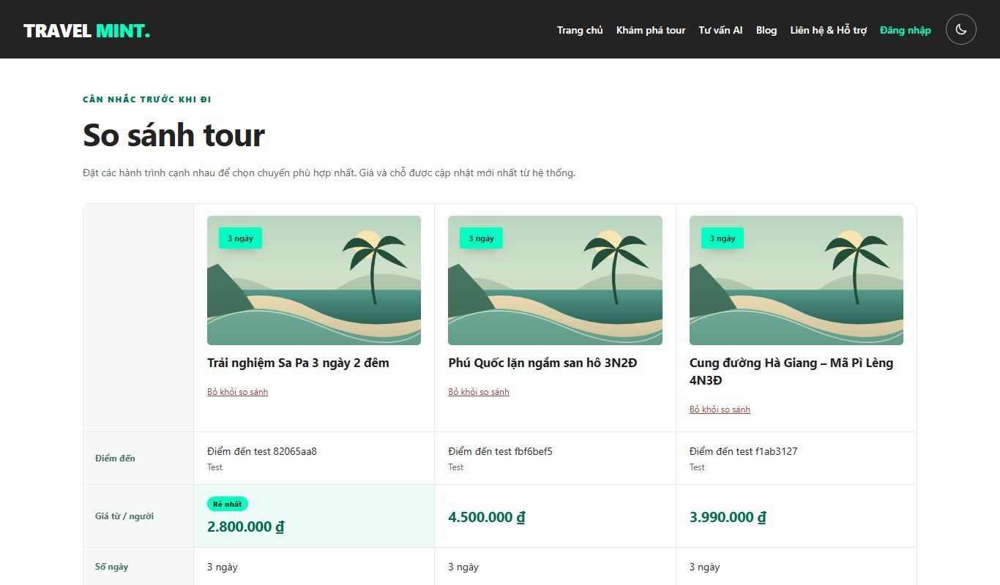
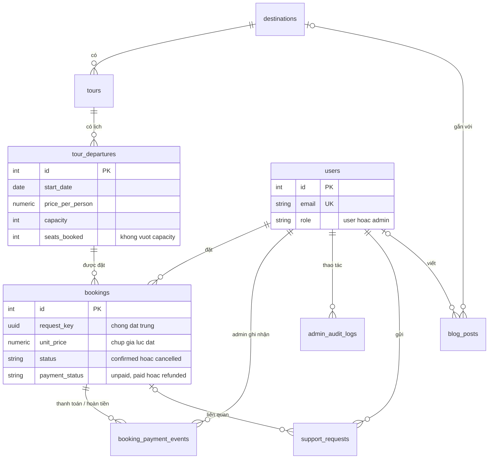

# 🌴 Travel Mint — Website đặt tour du lịch tích hợp AI

[](https://github.com/khoan2202/travel_AI_booking/actions/workflows/ci.yml)


Website đặt tour du lịch fullstack: khách xem, so sánh và đặt tour; admin quản lý tour, đơn đặt, người dùng và blog; trợ lý AI (Google Gemini) gợi ý tour phù hợp với nhu cầu.

🔗 **Demo:** https://travel.trizportal.com/  ·  📘 **Tài liệu API (Swagger):** `https://travel.trizportal.com/api-docs`


> **Tóm tắt bằng tiếng Anh (for reviewers):** a full-stack tour booking app built with React 19, Express 5 and PostgreSQL. It focuses on correctness under concurrency (row-level locking prevents overselling seats, idempotent booking requests), a security-minded backend (session auth, CSRF, rate limiting, audit log), an admin back office, a Markdown blog, and a Gemini-powered assistant with a deterministic fallback. It ships with Docker, a CI pipeline and 68 automated tests.

---

## 📸 Giao diện

| | |
|---|---|
|  |  |
| **Trang chủ** với banner bưu thiếp 3D, nghiêng theo chuột | **Giao diện tối**, nhớ lựa chọn của khách |
|  |  |
| **Blog** viết bằng Markdown | **So sánh** tối đa 3 tour cạnh nhau |
|  |  |
| **Trình soạn bài** có xem trước trực tiếp, hẹn giờ đăng | **Dashboard** quản trị (dữ liệu mẫu) |

---

## ✨ Tính năng chính

**Khách hàng**
- Xem danh sách tour, lọc theo khu vực / ngân sách / số ngày, xem chi tiết và lịch khởi hành còn chỗ
- **So sánh tối đa 3 tour** cạnh nhau (link so sánh có thể gửi cho bạn bè)
- **Quiz tìm chuyến đi** (chấm điểm ngay trên trình duyệt) và **trợ lý AI tư vấn tour** dựa trên catalog thật
- Đăng ký / đăng nhập, đặt tour, xem và hủy đơn của mình
- Đọc blog du lịch, gửi yêu cầu hỗ trợ
- Giao diện sáng / tối, dùng được trên điện thoại

**Quản trị (admin)**
- Dashboard: doanh thu 6 tháng, việc cần xử lý, tour bán chạy, tour sắp hết lịch khởi hành
- Quản lý tour (nhân bản, đổi trạng thái nhanh, tạo nhiều lịch khởi hành một lần), đơn đặt (xác nhận thanh toán, hoàn tiền, xuất CSV), người dùng và phân quyền
- Xử lý yêu cầu hỗ trợ, soạn bài blog (Markdown, hẹn giờ đăng)
- Nhật ký hoạt động: ghi lại mọi thao tác của admin

## 🧠 Điểm nhấn kỹ thuật

**Không bán quá số chỗ, kể cả khi nhiều người đặt cùng lúc.** Đặt tour chạy trong một transaction, khóa dòng lịch khởi hành bằng `SELECT ... FOR UPDATE` rồi mới kiểm tra và trừ chỗ; `CHECK (seats_booked <= capacity)` ở database là lớp bảo vệ cuối cùng. Có test cho 12 người đặt cùng lúc 5 chỗ cuối: đúng 5 người được chỗ ([`bookingService.js`](server/src/services/bookingService.js), [`booking.test.js`](server/test/booking.test.js)).

**Bấm hai lần hoặc rớt mạng không tạo đơn trùng.** Mỗi lần đặt có một `request_key` (UUID) do trình duyệt tạo và lưu tạm; gửi lại cùng mã thì server trả lại đơn cũ. Mã này chỉ được tái sử dụng khi nội dung y hệt.

**Không tin dữ liệu từ trình duyệt.** Giá và tổng tiền luôn lấy từ database; khách chỉ gửi giá họ đã thấy để server phát hiện giá vừa đổi. Quyền (`role`) đọc lại từ database ở mỗi request, không lấy từ phiên.

**Thao tác tiền bạc có dấu vết.** Ghi nhận thanh toán / hoàn tiền yêu cầu tick xác nhận, ghi chú và mã đối soát; mỗi thao tác của admin đều vào nhật ký (`admin_audit_logs`). Mỗi đơn chỉ có tối đa một lần thanh toán và một lần hoàn tiền (ràng buộc `UNIQUE` trong database).

**Blog an toàn trước XSS.** Bộ đọc Markdown tự viết ([`markdown.js`](client/src/utils/markdown.js)) chuyển nội dung thành các khối React, không dùng `dangerouslySetInnerHTML`; link `javascript:` và `//` bị chặn. Có test cho các trường hợp tấn công thường gặp.

**Migration chạy lại được nhiều lần.** Các file SQL `008`, `009` dùng `IF NOT EXISTS` / `ON CONFLICT DO NOTHING`; server không khởi động nếu thiếu bảng bắt buộc, còn các tính năng mới (blog, hỗ trợ) tự báo rõ khi database chưa chạy migration thay vì sập.

## 🛡️ Bảo mật

- Đăng nhập bằng session, mật khẩu băm bằng **bcrypt**, session lưu trong PostgreSQL; cấp lại mã phiên sau khi đăng nhập (chống session fixation)
- Đăng nhập luôn chạy so sánh mật khẩu kể cả khi email không tồn tại, để không dò được email nào đã đăng ký qua thời gian phản hồi
- **CSRF token** cho mọi request thay đổi dữ liệu, kiểm tra thêm `Origin`; origin lạ bị từ chối 403
- **Rate limiting** riêng cho đăng nhập, đăng ký, đặt tour, hỗ trợ và gọi AI
- Header bảo mật; trên production có thêm HSTS và **Content-Security-Policy** chặn script ngoài
- Giới hạn kích thước request, phân quyền `user` / `admin` ở cả frontend và backend
- CI chạy `npm audit` cho backend để chặn thư viện có lỗ hổng mức cao; Dependabot tự đề xuất bản vá

## 🤖 Trợ lý AI

- Gọi Google Gemini với system prompt chỉ cho phép tư vấn tour **có trong database**, không bịa giá hay chính sách
- Ép kết quả trả về dạng JSON (câu trả lời + tối đa 3 tour kèm lý do)
- **Giảm thiểu prompt injection:** coi câu hỏi và lịch sử là dữ liệu không đáng tin trong prompt, và quan trọng hơn là kiểm tra chặt đầu ra: tour AI chọn phải có trong danh sách đã gửi, không trùng, lý do hợp lệ; giá và số chỗ luôn lấy lại từ database
- Giới hạn 10 giây cho mỗi lần gọi, giới hạn tần suất theo IP và theo tài khoản để tránh tốn quota
- **Phương án dự phòng:** khi AI lỗi, quá giờ, trả sai định dạng hoặc chưa có API key, hệ thống tự gợi ý tour từ database, người dùng không thấy lỗi. Phần này có test với "Gemini giả" ([`unit.test.js`](server/test/unit.test.js))

## 🧰 Công nghệ

| Tầng | Công nghệ |
|------|-----------|
| Frontend | React 19, Vite, React Router, Context API, CSS thuần (không dùng thư viện UI) |
| Backend | Node.js 24, Express 5, REST API, Swagger UI |
| Database | PostgreSQL (Neon), 9 file migration SQL |
| AI | Google Gemini API |
| Kiểm thử | `node:test` (không cần thư viện ngoài), test tích hợp chạy trên PostgreSQL thật |
| DevOps | Docker + Docker Compose, GitHub Actions (lint, test, build, khởi động thử bằng Docker), Dependabot |
| Deploy | Render (một service phục vụ cả frontend và `/api`) + Neon Postgres |

## 🗄️ Mô hình dữ liệu



Ngoài ra có bảng `user_sessions` (phiên đăng nhập, dùng `connect-pg-simple`).

## 🗂️ Cấu trúc thư mục

```
travel_AI_booking/
├── Dockerfile · docker-compose.yml   # chạy cả hệ thống bằng một lệnh
├── .github/workflows/ci.yml          # CI: lint, test, build, thử khởi động bằng Docker
├── docs/screenshots/                 # ảnh dùng trong README
├── client/                           # Frontend React
│   └── src/
│       ├── pages/                    # 24 trang (khách + admin)
│       ├── components/               # Header, TourCard, CompareTray, RevenueChart...
│       ├── context/                  # AuthContext, CompareContext
│       ├── hooks/                    # useLoad (tải dữ liệu, tự hủy yêu cầu cũ)
│       ├── services/                 # Gọi API (tourApi, bookingApi, adminApi...)
│       ├── utils/                    # Markdown, quiz, định dạng (kèm *.test.js)
│       └── styles/                   # CSS theo từng khu vực, theme.css cho giao diện tối
└── server/                           # Backend Express
    ├── sql/                          # Migration 001 → 009 + script deploy
    ├── scripts/make-admin.js         # cấp quyền admin cho một tài khoản
    ├── test/                         # Test đơn vị + test tích hợp trên PostgreSQL
    └── src/
        ├── routes/                   # 11 nhóm route
        ├── controllers/              # Xử lý request
        ├── services/                 # Logic đặt tour, gợi ý, gọi AI
        ├── middleware/               # auth, csrf, security
        └── docs/openapi.js           # Tài liệu Swagger
```

## 🚀 Chạy trên máy

### Cách 1: Docker (nhanh nhất)

**Yêu cầu:** Docker Desktop. Không cần cài Node hay PostgreSQL.

```bash
docker compose up --build
```

Mở http://localhost:5000. Lần đầu, PostgreSQL tự chạy các file `server/sql/001 → 009` (tạo bảng, 22 tour mẫu, 6 bài blog). Cấu hình mặc định chỉ dành cho máy cá nhân; muốn đổi mật khẩu/khóa, sao chép `.env.example` thành `.env`.

```bash
# Tạo tài khoản admin: đăng ký trên website trước, rồi
docker compose exec app npm run make-admin -- email-cua-ban@example.com

# Xóa sạch dữ liệu để chạy lại từ đầu
docker compose down -v
```

### Cách 2: Chạy trực tiếp

**Yêu cầu:** Node.js 24, PostgreSQL (cài trên máy hoặc dùng Neon miễn phí).

```bash
# 1. Tạo database và chạy lần lượt các file migration (001 → 009)
createdb travel_ai_booking
for f in server/sql/0*.sql; do psql -d travel_ai_booking -v ON_ERROR_STOP=1 -f "$f"; done
# PowerShell: Get-ChildItem server/sql/0*.sql | ForEach-Object { psql -d travel_ai_booking -v ON_ERROR_STOP=1 -f $_.FullName }

# 2. Backend
cd server
cp .env.example .env      # điền thông tin PostgreSQL và SESSION_SECRET (GEMINI_API_KEY không bắt buộc)
npm install
npm run dev               # http://localhost:5000

# 3. Frontend (mở terminal khác)
cd client
npm install
npm run dev               # http://localhost:5173
```

Tạo tài khoản admin: đăng ký bình thường rồi chạy `npm run make-admin -- email-cua-ban@example.com` trong thư mục `server`.

## 🧪 Kiểm thử

```bash
# Frontend: lint + test (bộ đọc Markdown, chấm điểm quiz, định dạng...)
cd client
npm run lint && npm test

# Backend: cần một database RIÊNG có tên kết thúc bằng _test
createdb travel_test
for f in server/sql/0*.sql; do psql -d travel_test -v ON_ERROR_STOP=1 -f "$f"; done
cd server
PGDATABASE=travel_test npm test        # PowerShell: $env:PGDATABASE='travel_test'; npm test
```

Test backend tạo và xóa dữ liệu của chính nó nên **từ chối chạy** trên database không có đuôi `_test`, tránh xóa nhầm dữ liệu thật. Bộ test gồm: đăng ký/đăng nhập/phiên/CSRF/phân quyền, đặt tour (hết chỗ, đổi giá, gửi lại, **đặt đồng thời**, hủy, hoàn tiền), blog (bài nháp, hẹn giờ, ẩn/hiện), API admin, và logic dự phòng của trợ lý AI.

## ☁️ Deploy

Một service Node phục vụ cả giao diện đã build (`client/dist`) lẫn `/api` trên cùng một domain, nên không cần cấu hình CORS giữa hai nơi. Có thể deploy bằng `Dockerfile` hoặc build trực tiếp (`npm run build` trong `client`, `npm start` trong `server`).

| Biến môi trường | Ý nghĩa |
|---|---|
| `NODE_ENV=production` | Bật chế độ production (cookie `secure`, HSTS, CSP). Bắt buộc `CLIENT_URL` là https và `DATABASE_SSL=true` |
| `CLIENT_URL` | Địa chỉ website, ví dụ `https://travel.trizportal.com` (dùng cho CORS và CSRF) |
| `DATABASE_SSL=true` | Bật SSL tới database (Neon yêu cầu) |
| `PGHOST` `PGPORT` `PGDATABASE` `PGUSER` `PGPASSWORD` | Kết nối PostgreSQL |
| `SESSION_SECRET` | Khóa ký cookie, ít nhất 32 ký tự ngẫu nhiên |
| `GEMINI_API_KEY` | Không bắt buộc; bỏ trống thì AI dùng phương án dự phòng |

Trước lần deploy đầu tiên, chạy lần lượt các file `server/sql/001 → 009` trên database. Mỗi lần thêm migration mới, chạy file đó trên database thật trước khi deploy code cần đến nó.

## ⚠️ Giới hạn đã biết

- **Thanh toán là ghi sổ thủ công:** khách chưa trả tiền trực tuyến; admin xác nhận sau khi kiểm tra chuyển khoản. Chưa tích hợp cổng thanh toán.
- Chưa gửi email xác nhận đơn; hỗ trợ khách qua form liên hệ và trang quản trị.
- Tour, giá và lịch khởi hành là **dữ liệu mẫu**.
- Chưa có test giao diện end-to-end tự động (đã kiểm tra thủ công bằng trình duyệt).
- Ảnh bìa blog chọn từ ảnh có sẵn hoặc dán link https, chưa hỗ trợ tải ảnh lên.

## 📄 Giấy phép

Mã nguồn theo giấy phép [MIT](LICENSE). Ảnh điểm đến lấy từ Wikimedia Commons (CC BY, CC BY-SA, CC0, Public domain); tác giả và giấy phép từng ảnh được ghi tại trang `/credits` của website.

## 👤 Tác giả

**Phùng Khắc Khoan** — sinh viên Hệ thống Thông tin, Trường ĐH Công nghệ Thông tin (UIT – ĐHQG-HCM)
GitHub: [@khoan2202](https://github.com/khoan2202)
