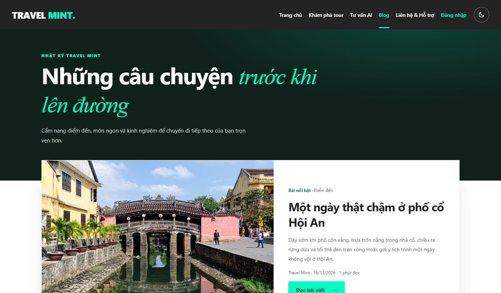
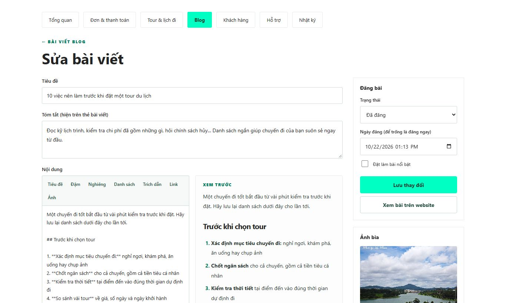
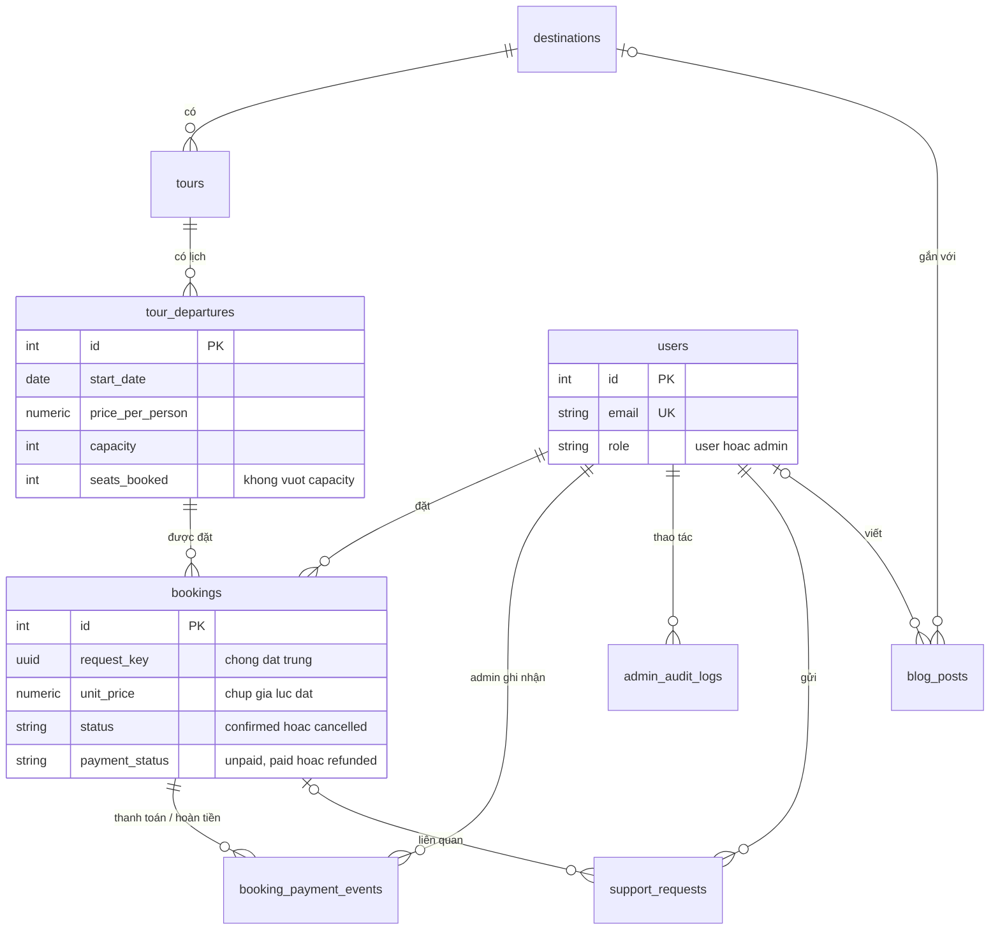

# 🌴 Travel Mint — Website đặt tour du lịch tích hợp AI


Website đặt tour du lịch fullstack: khách xem, lọc, so sánh và đặt tour; admin quản lý tour, đơn đặt, người dùng, blog và yêu cầu hỗ trợ; trợ lý AI (Google Gemini) gợi ý tour phù hợp với nhu cầu của từng khách.

🔗 **Demo:** https://travel.trizportal.com  ·  📘 **Tài liệu API (Swagger):** https://travel.trizportal.com/api-docs


> **English summary:** a full-stack tour booking web app built with React 19, Express 5 and PostgreSQL. It focuses on correctness under concurrency (row-level locking prevents overselling seats, idempotent booking requests), a security-minded backend (session authentication, bcrypt, CSRF tokens, per-route rate limiting, security headers, admin audit log), an admin back office, a Markdown blog, and a Google Gemini tour advisor with structured JSON output, prompt-injection guardrails and an automatic database fallback. Deployed on Vercel with a Neon Postgres database.

---

## 📸 Giao diện

| | |
|---|---|
|  |  |
| **Trang chủ** với banner bưu thiếp 3D, nghiêng theo chuột | **Giao diện tối**, nhớ lựa chọn của khách |
|  |  |
| **Blog** viết bằng Markdown | **So sánh** tối đa 3 tour cạnh nhau |
|  |  |
| **Trình soạn bài** có xem trước trực tiếp, hẹn giờ đăng | **Dashboard** quản trị (dữ liệu mẫu) |

---

## ✨ Tính năng

### Khách hàng
- **Khám phá tour:** danh sách tour theo điểm đến, lọc theo từ khóa, khu vực, ngân sách và số ngày; trang chi tiết có thư viện ảnh, lịch trình và các ngày khởi hành còn chỗ
- **Đặt tour:** chọn ngày khởi hành, số người lớn và trẻ em, xem tổng tiền trước khi xác nhận; xem lại danh sách đơn, chi tiết từng đơn và tự hủy đơn
- **Trợ lý AI tư vấn tour:** mô tả nhu cầu bằng lời (ví dụ "đi biển 3 ngày, ngân sách 5 triệu"), AI chọn tối đa 3 tour có thật trong hệ thống kèm lý do
- **Quiz tìm chuyến đi:** vài câu hỏi ngắn, chấm điểm ngay trên trình duyệt và gợi ý điểm đến hợp gu
- **So sánh tour:** chọn tối đa 3 tour để xem giá, thời lượng, lịch khởi hành cạnh nhau; link so sánh gửi được cho bạn bè
- **Blog du lịch:** bài viết theo điểm đến, có bài nổi bật và bài liên quan; trang chủ hiển thị bài mới
- **Liên hệ & hỗ trợ:** gửi yêu cầu hỗ trợ, có thể gắn với một đơn đặt cụ thể
- **Tài khoản:** đăng ký, đăng nhập, đăng xuất; sau khi đăng nhập quay lại đúng trang đang xem
- **Trải nghiệm:** giao diện sáng/tối, hiệu ứng chuyển động nhẹ, dùng tốt trên điện thoại; trang ghi nguồn ảnh (`/credits`)

### Quản trị (admin)
- **Dashboard:** doanh thu 6 tháng (biểu đồ), danh sách việc cần xử lý, tour bán chạy, tour sắp hết lịch khởi hành, đơn mới gần đây
- **Quản lý tour:** thêm, sửa, nhân bản tour, đổi trạng thái nhanh; quản lý lịch khởi hành, tạo nhiều lịch một lần
- **Quản lý đơn đặt:** lọc và tìm đơn, xem chi tiết, ghi nhận thanh toán và hoàn tiền (kèm ghi chú, mã đối soát), xuất CSV
- **Người dùng:** tìm kiếm, cấp hoặc gỡ quyền admin
- **Blog:** soạn bài bằng Markdown có thanh công cụ và xem trước trực tiếp, lưu nháp, hẹn giờ đăng, ẩn/hiện bài
- **Hỗ trợ khách hàng:** hộp thư yêu cầu hỗ trợ, cập nhật trạng thái xử lý
- **Nhật ký hoạt động:** ghi lại mọi thao tác của admin (ai, làm gì, lúc nào)

## 🧰 Công nghệ

| Tầng | Công nghệ |
|------|-----------|
| Frontend | React 19, Vite, React Router, Context API, CSS thuần (không dùng thư viện UI) |
| Backend | Node.js 24, Express 5, REST API (11 nhóm route), Swagger/OpenAPI |
| Database | PostgreSQL trên Neon, 10 file migration SQL |
| Xác thực & bảo mật | express-session + connect-pg-simple, bcrypt, CSRF token, express-rate-limit |
| AI | Google Gemini API |
| Deploy | Vercel (giao diện tĩnh + Express chạy dạng Serverless Function) + Neon Postgres |
| Công cụ | Git/GitHub, ESLint |

## 🧠 Điểm nhấn kỹ thuật

**Không bán quá số chỗ, kể cả khi nhiều người đặt cùng lúc.** Đặt tour chạy trong một transaction, khóa dòng lịch khởi hành bằng `SELECT ... FOR UPDATE` rồi mới kiểm tra và trừ chỗ; ràng buộc `CHECK (seats_booked <= capacity)` trong database là lớp bảo vệ cuối cùng ([`bookingService.js`](server/src/services/bookingService.js)).

**Bấm hai lần hoặc rớt mạng không tạo đơn trùng.** Mỗi lần đặt có một `request_key` (UUID) do trình duyệt tạo và lưu tạm; gửi lại cùng mã thì server trả về đơn cũ. Mã này chỉ được dùng lại khi nội dung đơn y hệt.

**Không tin dữ liệu từ trình duyệt.** Giá và tổng tiền luôn lấy từ database; khách chỉ gửi giá họ đã thấy để server phát hiện giá vừa thay đổi. Quyền `user`/`admin` được đọc lại từ database ở mỗi request, không lấy từ phiên.

**Thao tác tiền bạc có dấu vết.** Ghi nhận thanh toán hoặc hoàn tiền phải tick xác nhận, nhập ghi chú và mã đối soát; mỗi thao tác của admin đều được ghi vào nhật ký (`admin_audit_logs`). Mỗi đơn chỉ có tối đa một lần thanh toán và một lần hoàn tiền (ràng buộc `UNIQUE` trong database).

**Blog an toàn trước XSS.** Bộ đọc Markdown tự viết ([`markdown.js`](client/src/utils/markdown.js)) chuyển nội dung thành các phần tử React, không dùng `dangerouslySetInnerHTML`; link `javascript:` và `//` bị chặn.

**Migration chạy lại được nhiều lần.** Các file SQL `008`, `009`, `010` dùng `IF NOT EXISTS` / `ON CONFLICT DO NOTHING`; các tính năng như blog và hỗ trợ tự báo rõ khi database chưa chạy migration thay vì làm sập trang.

## 🛡️ Bảo mật

- Đăng nhập bằng **session lưu trong PostgreSQL**, mật khẩu băm bằng **bcrypt**; đổi mã phiên sau khi đăng nhập (chống session fixation)
- Cookie phiên `httpOnly`, `secure` trên production, `SameSite=Lax`
- Đăng nhập luôn chạy so sánh mật khẩu kể cả khi email không tồn tại, để không dò được email nào đã đăng ký qua thời gian phản hồi
- **CSRF token** cho mọi request thay đổi dữ liệu, kèm kiểm tra `Origin`; nguồn lạ bị từ chối
- **Rate limiting** riêng cho đăng nhập, đăng ký, đặt tour, form hỗ trợ và trợ lý AI
- **Header bảo mật:** Content-Security-Policy chặn script ngoài, HSTS, X-Frame-Options, X-Content-Type-Options, Referrer-Policy
- Giới hạn kích thước request, câu SQL luôn dùng tham số, phân quyền `user` / `admin` ở cả frontend và backend

## 🤖 Trợ lý AI

- Gọi Google Gemini từ server (khóa API không bao giờ xuống trình duyệt), với system prompt chỉ cho phép tư vấn tour **có trong database**, không bịa giá hay chính sách
- **Structured output:** ép kết quả về JSON theo schema (câu trả lời + tối đa 3 tour kèm lý do)
- **Giảm thiểu prompt injection:** coi câu hỏi và lịch sử chat là dữ liệu không đáng tin, và quan trọng hơn là kiểm tra chặt đầu ra: tour AI chọn phải nằm trong danh sách đã gửi, không trùng, có lý do hợp lệ; giá và số chỗ luôn lấy lại từ database
- Giới hạn 10 giây cho mỗi lần gọi, giới hạn tần suất theo IP và theo tài khoản để không tốn quota
- **Phương án dự phòng:** khi AI lỗi, quá giờ, trả sai định dạng hoặc chưa có API key, hệ thống tự gợi ý tour từ database, người dùng không thấy lỗi ([`consultationService.js`](server/src/services/consultationService.js))

## 🗄️ Mô hình dữ liệu



Ngoài ra có bảng `user_sessions` lưu phiên đăng nhập (dùng `connect-pg-simple`).

## 🗂️ Cấu trúc thư mục

```
travel_AI_booking/
├── api/index.js                  # điểm vào của backend trên Vercel
├── vercel.json                   # cấu hình build, định tuyến và header bảo mật cho Vercel
├── docs/screenshots/             # ảnh dùng trong README
├── client/                       # Frontend React (Vite)
│   ├── public/                   # ảnh, favicon, theme-init.js
│   └── src/
│       ├── pages/                # 24 trang (khách + admin)
│       ├── components/           # Header, Hero, TourCard, CompareTray, RevenueChart...
│       ├── context/              # AuthContext, CompareContext
│       ├── hooks/                # useLoad (tải dữ liệu, tự hủy yêu cầu cũ)
│       ├── services/             # hàm gọi API (tourApi, bookingApi, adminApi...)
│       ├── utils/                # Markdown, quiz, định dạng tiền và ngày
│       └── styles/               # CSS theo từng khu vực, theme.css cho giao diện tối
└── server/                       # Backend Express
    ├── sql/                      # migration 001 → 010 (tạo bảng + dữ liệu mẫu)
    ├── scripts/make-admin.js     # cấp quyền admin cho một tài khoản
    └── src/
        ├── routes/               # 11 nhóm API
        ├── controllers/          # xử lý request
        ├── services/             # logic đặt tour, gợi ý, gọi Gemini
        ├── middleware/           # auth, csrf, security headers
        ├── config/               # cấu hình session
        ├── db/                   # kết nối PostgreSQL, transaction
        └── docs/openapi.js       # tài liệu Swagger
```

## 🚀 Chạy trên máy

**Cần có:** Node.js 24 và PostgreSQL (cài trên máy hoặc dùng Neon miễn phí).

```bash
# 1. Tạo database rồi chạy lần lượt các file server/sql/001 → 010 (bằng pgAdmin hoặc psql)
createdb travel_ai_booking
for f in server/sql/0*.sql; do psql -d travel_ai_booking -v ON_ERROR_STOP=1 -f "$f"; done
# PowerShell: Get-ChildItem server/sql/0*.sql | ForEach-Object { psql -d travel_ai_booking -v ON_ERROR_STOP=1 -f $_.FullName }

# 2. Backend
cd server
cp .env.example .env      # điền thông tin PostgreSQL và SESSION_SECRET (GEMINI_API_KEY không bắt buộc)
npm install
npm run dev               # http://localhost:5000  ·  Swagger: http://localhost:5000/api-docs

# 3. Frontend (mở terminal khác)
cd client
npm install
npm run dev               # http://localhost:5173
```

Tạo tài khoản admin: đăng ký trên website, rồi chạy `npm run make-admin -- email-cua-ban@example.com` trong thư mục `server`.

Kiểm tra code: `npm run lint` trong `client` và `server` (ESLint).

## ☁️ Deploy lên Vercel

Giao diện và API nằm trên **cùng một domain**: Vercel phục vụ giao diện đã build, còn mọi request `/api/*` và `/api-docs` chạy qua app Express trong [`api/index.js`](api/index.js) dưới dạng Serverless Function. Vì vậy cookie đăng nhập dùng `SameSite=Lax` và không cần cấu hình CORS giữa hai nơi.

1. Chạy các file `server/sql/001 → 010` trên database Neon.
2. Import repo vào Vercel, giữ nguyên *Root Directory*; [`vercel.json`](vercel.json) đã khai báo sẵn cách cài, build, định tuyến và header bảo mật.
3. Thêm biến môi trường rồi deploy:

| Biến | Ý nghĩa |
|---|---|
| `DATABASE_URL` | Chuỗi kết nối PostgreSQL (Neon) |
| `SESSION_SECRET` | Khóa ký cookie, ít nhất 32 ký tự ngẫu nhiên |
| `CLIENT_URL` | Địa chỉ website, ví dụ `https://ten-du-an.vercel.app` (dùng cho CORS và CSRF) |
| `NODE_ENV` | `production`: bật cookie `secure`, HSTS, CSP |
| `DATABASE_SSL` | `true` (Neon yêu cầu SSL) |
| `GEMINI_API_KEY` | Không bắt buộc; bỏ trống thì trợ lý AI dùng phương án gợi ý từ database |

Muốn chạy trên một server Node bình thường (Render, VPS...): `npm run build` trong `client`, rồi `npm start` trong `server`; backend sẽ phục vụ luôn giao diện đã build.

## 👤 Tác giả

**Phùng Khắc Khoan**, sinh viên Hệ thống Thông tin, Trường ĐH Công nghệ Thông tin (UIT – ĐHQG-HCM) · GitHub: [@khoan2202](https://github.com/khoan2202)

**Về việc dùng AI:** mình dùng Claude (Anthropic) làm trợ lý lập trình, ước chừng 60% lượng code được viết cùng AI (code khung, refactor, rà lỗi bảo mật). Mình quyết định cách làm, đọc lại và chỉnh từng thay đổi, chạy thử trên máy và deploy.

## 📄 Giấy phép

Mã nguồn theo giấy phép [MIT](LICENSE). Ảnh điểm đến lấy từ Wikimedia Commons (CC BY, CC BY-SA, CC0, Public domain); tác giả và giấy phép từng ảnh được ghi tại trang `/credits` của website.
