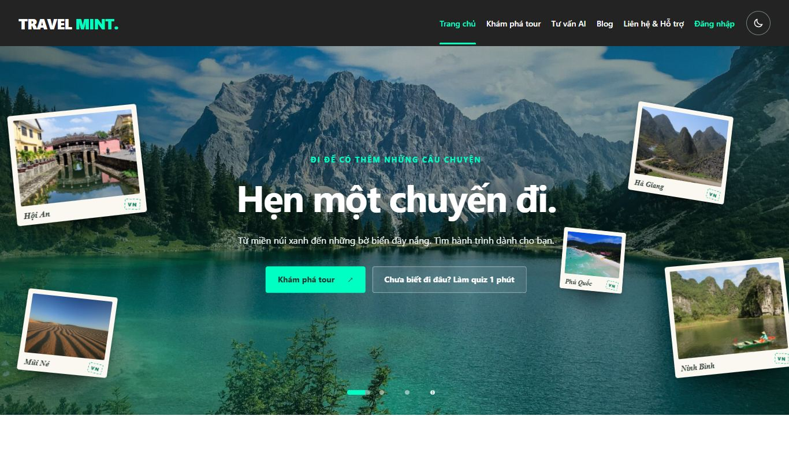
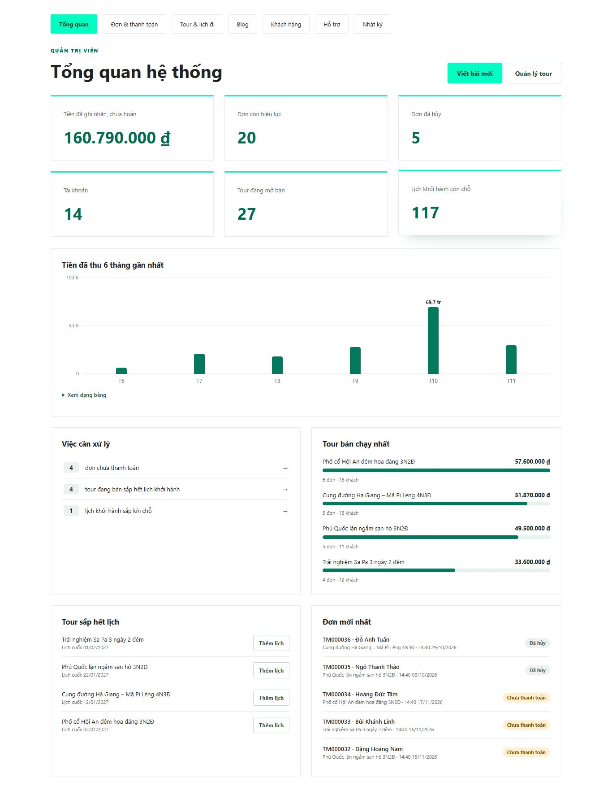
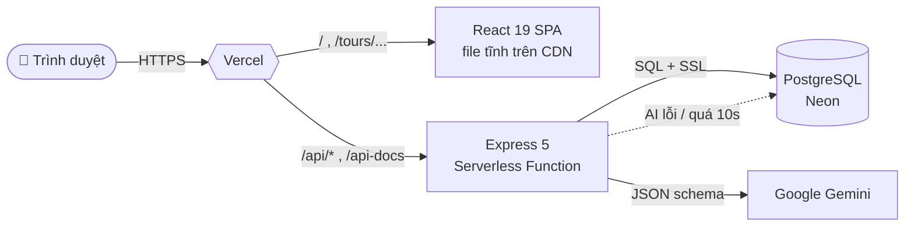
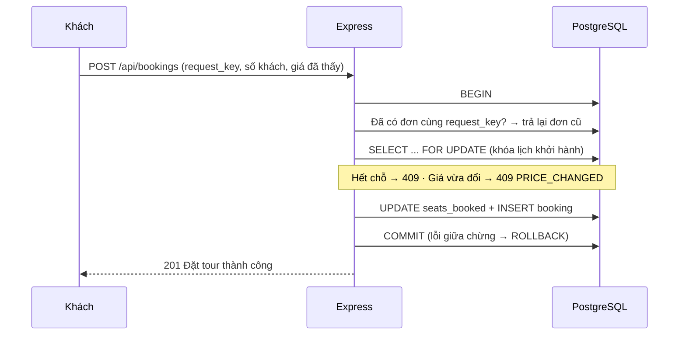
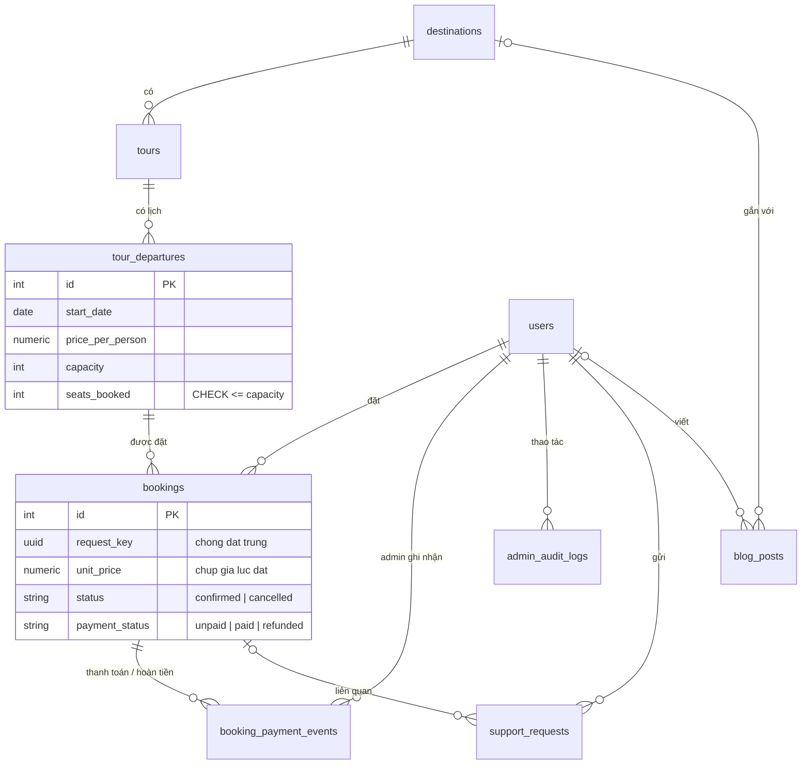

<div align="center">

# 🌴 Travel Mint

**Website đặt tour du lịch fullstack tích hợp trợ lý AI**

Khách tìm, so sánh và đặt tour · Admin quản lý toàn bộ hệ thống · Gemini gợi ý tour theo nhu cầu

[](https://travel-khacdichoi.vercel.app)
[](https://travel-khacdichoi.vercel.app/api-docs)


</div>

> **🇬🇧 English summary.** Travel Mint is a full-stack tour booking platform built with **React 19, Express 5 and PostgreSQL**, deployed on **Vercel + Neon**. It features concurrency-safe seat booking (row-level locking, idempotent requests), a security-hardened backend (PostgreSQL-backed sessions, bcrypt, CSRF tokens, per-route rate limiting, CSP/HSTS), a full admin back office with audit logging, a Markdown blog, and a **Google Gemini tour advisor** with structured JSON output, prompt-injection guardrails and an automatic database fallback. The REST API exposes 44 endpoints documented with Swagger/OpenAPI.

---

## 📸 Giao diện

<table>
  <tr>
    <td width="50%"><p align="center"><b>Trang chủ</b>: banner bưu thiếp 3D nghiêng theo chuột</p></td>
    <td width="50%"><p align="center"><b>Giao diện tối</b>: nhớ lựa chọn của khách</p></td>
  </tr>
  <tr>
    <td><p align="center"><b>So sánh tour</b> cạnh nhau</p></td>
    <td><p align="center"><b>Blog</b> du lịch viết bằng Markdown</p></td>
  </tr>
  <tr>
    <td><p align="center"><b>Dashboard</b> quản trị (dữ liệu mẫu)</p></td>
    <td><p align="center"><b>Trình soạn bài</b> có xem trước trực tiếp</p></td>
  </tr>
</table>

---

## ✨ Tính năng

| 🧳 Khách hàng | 🛠️ Quản trị viên |
|---|---|
| Tìm và lọc tour theo khu vực, ngân sách, số ngày | **Dashboard**: doanh thu 6 tháng, tour bán chạy, việc cần xử lý |
| Xem chi tiết tour, thư viện ảnh, lịch khởi hành còn chỗ | Quản lý tour: thêm, sửa, nhân bản, đổi trạng thái nhanh |
| **Đặt tour**, xem lại và tự hủy đơn | Tạo hàng loạt lịch khởi hành |
| **Trợ lý AI** gợi ý tour bằng ngôn ngữ tự nhiên | Quản lý đơn: ghi nhận thanh toán, hoàn tiền, **xuất CSV** |
| **So sánh** tối đa 3 tour, chia sẻ bằng link | Quản lý người dùng và phân quyền admin |
| Quiz tìm điểm đến hợp gu | Soạn blog **Markdown**: xem trước trực tiếp, lưu nháp, hẹn giờ đăng |
| Blog du lịch theo điểm đến | Hộp thư yêu cầu hỗ trợ, cập nhật trạng thái xử lý |
| Gửi yêu cầu hỗ trợ, giao diện sáng/tối, responsive | **Nhật ký hoạt động**: ai làm gì, lúc nào |

---

## 🏗️ Kiến trúc

Giao diện và API chạy trên **cùng một domain**, nên cookie đăng nhập dùng `SameSite=Lax` và không cần cấu hình CORS giữa hai nơi.



| Tầng | Vai trò |
|---|---|
| `client/` | React + Vite, định tuyến bằng React Router, trạng thái chung qua Context API, CSS thuần |
| `server/src/routes` → `controllers` → `services` | API chia theo tầng: nhận request, xử lý nghiệp vụ, truy vấn database |
| `server/src/middleware` | Xác thực, phân quyền, CSRF, header bảo mật |
| `api/index.js` | Bọc app Express thành Serverless Function trên Vercel |

---

## 🧠 Điểm nhấn kỹ thuật

### 1. Không bán quá số chỗ khi nhiều người đặt cùng lúc

Đặt tour chạy trong một transaction. Dòng lịch khởi hành bị **khóa bằng `SELECT ... FOR UPDATE`**, nên người đặt sau phải chờ người trước xong rồi mới đọc số chỗ mới nhất. Ràng buộc `CHECK (seats_booked <= capacity)` trong database là lớp bảo vệ cuối cùng.



> Code: [`bookingService.js`](server/src/services/bookingService.js) · [`transaction.js`](server/src/db/transaction.js)

### 2. Bấm hai lần không tạo đơn trùng (idempotency)
Mỗi lần đặt có một `request_key` (UUID) do trình duyệt tạo. Gửi lại cùng mã thì server trả về đơn cũ thay vì tạo đơn mới. Bấm đúp hay rớt mạng giữa chừng đều an toàn.

### 3. Không tin dữ liệu từ trình duyệt
Giá và tổng tiền luôn lấy từ database. Khách chỉ gửi giá họ đã thấy, để server phát hiện giá vừa thay đổi. Quyền `user`/`admin` được **đọc lại từ database ở mỗi request**, không lấy từ phiên.

### 4. Thao tác tiền bạc có dấu vết
Ghi nhận thanh toán hoặc hoàn tiền phải xác nhận, kèm ghi chú và mã đối soát. Mỗi đơn chỉ có tối đa một lần thanh toán và một lần hoàn tiền (ràng buộc `UNIQUE`). Mọi thao tác của admin được ghi vào `admin_audit_logs`.

### 5. Database thiết kế chặt chẽ

<details>
<summary><b>Xem sơ đồ quan hệ (ERD)</b></summary>



</details>

- 10 file migration SQL; các file mới dùng `IF NOT EXISTS` / `ON CONFLICT DO NOTHING` nên chạy lại nhiều lần vẫn an toàn
- Index được thêm theo đúng các truy vấn thật trong code
- Transaction tự hủy khi chờ khóa quá 5 giây hoặc chạy quá 10 giây, tránh treo hệ thống

---

## 🛡️ Bảo mật

| Mối nguy | Cách phòng chống |
|---|---|
| Lộ mật khẩu khi lộ database | Băm bằng **bcrypt** (cost 12), không bao giờ lưu mật khẩu gốc |
| Đánh cắp / cài sẵn phiên | **Session lưu trong PostgreSQL**, cookie `httpOnly` + `secure` + `SameSite=Lax`, đổi mã phiên sau khi đăng nhập |
| Dò email đã đăng ký | Email không tồn tại vẫn chạy so sánh bcrypt, thời gian phản hồi như nhau |
| CSRF (trang lạ gửi request thay khách) | **CSRF token** trong header cho mọi request ghi dữ liệu, so sánh an toàn thời gian, kiểm tra thêm `Origin` |
| Dò mật khẩu, spam, tốn quota AI | **Rate limiting** riêng cho đăng nhập, đăng ký, đặt tour, form hỗ trợ và AI (theo IP và theo tài khoản) |
| XSS, clickjacking | **Content-Security-Policy**, HSTS, `X-Frame-Options: DENY`; blog Markdown render thành phần tử React, không dùng `dangerouslySetInnerHTML` |
| SQL injection | Mọi câu SQL dùng tham số `$1, $2…` |
| Lộ thông tin khi lỗi | Giới hạn kích thước request; lỗi trả câu chung chung, chi tiết chỉ ghi log |

---

## 🤖 Trợ lý AI

Khách mô tả nhu cầu bằng lời (ví dụ *"đi biển 3 ngày, ngân sách 5 triệu"*), trợ lý chọn tối đa 3 tour **có thật trong hệ thống** kèm lý do.

- **Khóa API chỉ nằm ở server**, không bao giờ xuống trình duyệt
- **Structured output:** Gemini buộc trả JSON theo schema `{ answer, recommendations: [{ tour_id, reason }] }`
- **Chống prompt injection:** coi câu hỏi là dữ liệu không đáng tin, và **kiểm tra chặt đầu ra**: tour AI chọn phải nằm trong danh sách đã gửi, không trùng, có lý do hợp lệ
- **Không để AI bịa giá:** giá và số chỗ luôn lấy lại từ database
- **Timeout 10 giây** và giới hạn tần suất để không tốn quota
- **Phương án dự phòng:** AI lỗi, quá giờ, trả sai định dạng hoặc chưa có khóa API thì tự gợi ý tour từ database; khách không bao giờ gặp trang lỗi

> Code: [`consultationService.js`](server/src/services/consultationService.js)

---

## 🧰 Công nghệ

| Tầng | Công nghệ |
|---|---|
| **Frontend** | React 19 · Vite · React Router · Context API · CSS thuần (không dùng thư viện UI) |
| **Backend** | Node.js 24 · Express 5 · REST API · Swagger/OpenAPI |
| **Database** | PostgreSQL (Neon) · `pg` · 10 file migration SQL |
| **Xác thực & bảo mật** | express-session · connect-pg-simple · bcrypt · CSRF token · express-rate-limit |
| **AI** | Google Gemini API |
| **Hạ tầng** | Vercel (CDN + Serverless Function) · Neon Postgres |
| **Công cụ** | Git/GitHub · ESLint |

---

## 🔌 REST API

**44 endpoint**, chia thành 11 nhóm route. Tài liệu đầy đủ và thử trực tiếp tại **[Swagger UI](https://travel-khacdichoi.vercel.app/api-docs)**.

| Nhóm | Ví dụ | Quyền |
|---|---|---|
| Tour | `GET /api/tours` · `GET /api/tours/:id` · `GET /api/tours/:id/departures` | Công khai |
| Xác thực | `GET /api/auth/csrf` · `POST /api/auth/register` · `POST /api/auth/login` · `POST /api/auth/logout` | Công khai |
| Đặt tour | `GET /api/bookings` · `POST /api/bookings` · `POST /api/bookings/:id/cancel` | Đăng nhập |
| Trợ lý AI | `GET /api/recommendations` (công khai) · `POST /api/recommendations/consult` | Đăng nhập |
| Blog | `GET /api/blog` · `GET /api/blog/:slug` | Công khai |
| Hỗ trợ | `POST /api/support` | Công khai |
| Quản trị | `/api/admin/overview` · `/tours` · `/bookings` · `/users` · `/posts` · `/support` · `/activity` (26 endpoint) | Admin |

---

## 🚀 Chạy trên máy

**Yêu cầu:** Node.js 24 và PostgreSQL.

```bash
# 1. Clone
git clone https://github.com/khoan2202/travel_AI_booking.git
cd travel_AI_booking

# 2. Database: tạo bảng và dữ liệu mẫu (22 tour, bài blog mẫu)
createdb travel_ai_booking
for f in server/sql/0*.sql; do psql -d travel_ai_booking -v ON_ERROR_STOP=1 -f "$f"; done

# 3. Backend → http://localhost:5000  (Swagger: /api-docs)
cd server
cp .env.example .env      # điền thông tin PostgreSQL và SESSION_SECRET
npm install
npm run dev

# 4. Frontend → http://localhost:5173  (mở terminal khác)
cd client
npm install
npm run dev
```

**Tạo tài khoản admin:** đăng ký trên website, rồi chạy trong thư mục `server`:

```bash
npm run make-admin -- email-cua-ban@example.com
```

<details>
<summary><b>Biến môi trường của backend</b> (<code>server/.env</code>)</summary>

| Biến | Bắt buộc | Ý nghĩa |
|---|---|---|
| `PGHOST` `PGPORT` `PGDATABASE` `PGUSER` `PGPASSWORD` | ✅ (hoặc `DATABASE_URL`) | Kết nối PostgreSQL |
| `DATABASE_URL` | | Chuỗi kết nối thay cho các biến `PG*` |
| `SESSION_SECRET` | ✅ | Khóa ký cookie, ít nhất 32 ký tự ngẫu nhiên |
| `CLIENT_URL` | | Địa chỉ giao diện (mặc định `http://localhost:5173`) |
| `GEMINI_API_KEY` | | Khóa Gemini; bỏ trống thì trợ lý dùng gợi ý từ database |
| `GEMINI_MODEL` | | Tên model Gemini (mặc định `gemini-3.5-flash-lite`) |

</details>

---

## ☁️ Deploy

Dự án deploy trên **Vercel** (giao diện + API) và **Neon** (PostgreSQL). Toàn bộ cấu hình build, định tuyến và header bảo mật nằm trong [`vercel.json`](vercel.json).

<details>
<summary><b>Các bước deploy</b></summary>

1. Chạy các file `server/sql/001 → 010` trên database Neon.
2. Import repo vào Vercel: *Application Preset* chọn **Other**, giữ nguyên *Root Directory*.
3. Thêm biến môi trường rồi bấm Deploy:

| Biến | Giá trị |
|---|---|
| `DATABASE_URL` | Chuỗi kết nối Neon |
| `SESSION_SECRET` | Chuỗi ngẫu nhiên, ít nhất 32 ký tự |
| `CLIENT_URL` | Domain của website, ví dụ `https://travel-khacdichoi.vercel.app` |
| `NODE_ENV` | `production` |
| `DATABASE_SSL` | `true` |
| `GEMINI_API_KEY` | Khóa Gemini (không bắt buộc) |

</details>

<details>
<summary><b>Cấu trúc thư mục</b></summary>

```
travel_AI_booking/
├── api/index.js              # điểm vào backend trên Vercel
├── vercel.json               # build, định tuyến, header bảo mật
├── client/                   # Frontend React (Vite)
│   └── src/
│       ├── pages/            # 24 trang (khách + admin)
│       ├── components/       # Header, Hero, TourCard, RevenueChart...
│       ├── context/          # đăng nhập, so sánh tour
│       ├── hooks/            # useLoad: tải dữ liệu, tự hủy request cũ
│       ├── services/         # hàm gọi API
│       ├── utils/            # Markdown, quiz, định dạng
│       └── styles/           # CSS theo khu vực, theme sáng/tối
└── server/                   # Backend Express
    ├── sql/                  # migration 001 → 010
    ├── scripts/make-admin.js # cấp quyền admin
    └── src/
        ├── routes/           # 11 nhóm API
        ├── controllers/      # nhận và trả request
        ├── services/         # nghiệp vụ: đặt tour, gợi ý, gọi Gemini
        ├── middleware/       # auth, csrf, security headers
        ├── config/           # session
        ├── db/               # pool kết nối, transaction
        └── docs/             # tài liệu OpenAPI
```

</details>

---

## 👤 Tác giả

**Phùng Khắc Khoan**

Sinh viên Hệ thống Thông tin, Trường ĐH Công nghệ Thông tin (UIT – ĐHQG-HCM)

[](https://github.com/khoan2202)

**Về việc dùng AI:** mình dùng Claude (Anthropic) làm trợ lý lập trình hỗ trợ phần code (code khung, refactor, rà lỗi bảo mật). Mình quyết định cách làm, đọc lại và chỉnh từng thay đổi, chạy thử trên máy và deploy.

## 📄 Giấy phép

Mã nguồn theo giấy phép [MIT](LICENSE). Ảnh điểm đến lấy từ Wikimedia Commons (CC BY, CC BY-SA, CC0, Public domain); tác giả và giấy phép từng ảnh được ghi tại trang [`/credits`](https://travel-khacdichoi.vercel.app/credits).
