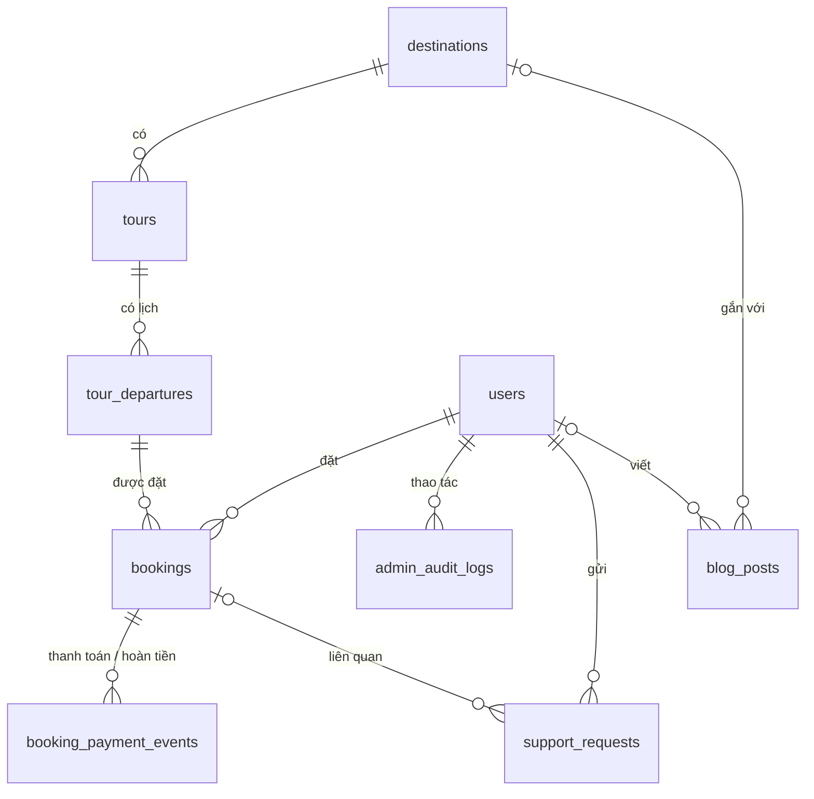

# 🌴 Travel Mint: website đặt tour du lịch tích hợp AI


Website đặt tour fullstack: khách tìm, so sánh và đặt tour; admin quản lý toàn bộ hệ thống; trợ lý AI gợi ý tour theo nhu cầu.

> **EN:** Full-stack tour booking app (React 19, Express 5, PostgreSQL) with concurrency-safe booking, a security-hardened backend, an admin back office and a Gemini-powered tour advisor.

🔗 **[Demo](https://travel-khacdichoi.vercel.app/)** · 📘 **[API docs (Swagger)](https://travel-khacdichoi.vercel.app//api-docs)**


## ✨ Tính năng

| Khách hàng | Quản trị |
|---|---|
| Tìm và lọc tour (khu vực, ngân sách, số ngày) | Dashboard doanh thu, tour bán chạy, việc cần xử lý |
| Đặt tour, xem và hủy đơn | Quản lý tour, lịch khởi hành (tạo hàng loạt) |
| **Trợ lý AI** gợi ý tour bằng ngôn ngữ tự nhiên | Quản lý đơn: thanh toán, hoàn tiền, xuất CSV |
| So sánh tối đa 3 tour, chia sẻ bằng link | Phân quyền người dùng |
| Quiz tìm điểm đến, blog du lịch | Soạn blog Markdown, xem trước, hẹn giờ đăng |
| Gửi yêu cầu hỗ trợ, giao diện sáng/tối | Hộp thư hỗ trợ, nhật ký thao tác admin |

## 🧠 Điểm nhấn kỹ thuật

- **Không bán quá số chỗ** khi nhiều người đặt cùng lúc: transaction + `SELECT ... FOR UPDATE`, thêm ràng buộc `CHECK` trong database ([bookingService.js](server/src/services/bookingService.js))
- **Không tạo đơn trùng** khi bấm hai lần hoặc rớt mạng: mỗi lần đặt có `request_key` (idempotency key)
- **Không tin dữ liệu từ trình duyệt:** giá luôn lấy từ database, quyền được kiểm tra lại ở mỗi request
- **Bảo mật:** session lưu trong PostgreSQL, bcrypt, CSRF token, rate limiting, CSP/HSTS, SQL tham số hóa
- **AI an toàn:** Gemini trả JSON theo schema, kiểm tra chặt đầu ra để chống prompt injection, tự chuyển sang gợi ý từ database khi AI lỗi ([consultationService.js](server/src/services/consultationService.js))
- **Blog chống XSS:** bộ đọc Markdown tự viết, không dùng `dangerouslySetInnerHTML` ([markdown.js](client/src/utils/markdown.js))
- **Có dấu vết:** mọi thao tác của admin được ghi vào `admin_audit_logs`

## 🧰 Công nghệ

| | |
|---|---|
| **Frontend** | React 19, Vite, React Router, Context API, CSS thuần |
| **Backend** | Node.js 24, Express 5, REST API, Swagger/OpenAPI |
| **Database** | PostgreSQL (Neon), 10 file migration SQL |
| **AI** | Google Gemini API |
| **Deploy** | Vercel (frontend + Express dạng Serverless Function), Neon |

## 📸 Giao diện

| | |
|---|---|
|  |  |
|  |  |
|  |  |

<details>
<summary><b>🗄️ Mô hình dữ liệu</b></summary>



</details>

<details>
<summary><b>🗂️ Cấu trúc thư mục</b></summary>

```
├── api/index.js       # điểm vào backend trên Vercel
├── client/            # React (Vite): pages, components, context, services, styles
└── server/
    ├── sql/           # migration 001 → 010
    ├── scripts/       # make-admin.js
    └── src/           # routes, controllers, services, middleware, db
```

</details>

## 🚀 Chạy trên máy

Cần **Node.js 24** và **PostgreSQL**.

```bash
# 1. Database
createdb travel_ai_booking
for f in server/sql/0*.sql; do psql -d travel_ai_booking -v ON_ERROR_STOP=1 -f "$f"; done

# 2. Backend: http://localhost:5000
cd server && cp .env.example .env && npm install && npm run dev

# 3. Frontend: http://localhost:5173 (terminal khác)
cd client && npm install && npm run dev
```

Cấp quyền admin: đăng ký tài khoản trên web, rồi chạy `npm run make-admin -- email@example.com` trong `server`.

<details>
<summary><b>☁️ Deploy lên Vercel</b></summary>

1. Chạy các file `server/sql/001 → 010` trên database Neon.
2. Import repo vào Vercel (cấu hình có sẵn trong [`vercel.json`](vercel.json)).
3. Thêm biến môi trường: `DATABASE_URL`, `SESSION_SECRET` (≥ 32 ký tự), `CLIENT_URL`, `NODE_ENV=production`, `DATABASE_SSL=true`, `GEMINI_API_KEY` (không bắt buộc).

</details>

## 👤 Tác giả

**Phùng Khắc Khoan**, sinh viên Hệ thống Thông tin, Trường ĐH Công nghệ Thông tin (UIT – ĐHQG-HCM) ·

GitHub: [@khoan2202](https://github.com/khoan2202)

**Về việc dùng AI:** mình dùng Claude (Anthropic) làm trợ lý lập trình hỗ trợ phần code (code khung, refactor, rà lỗi bảo mật). Mình quyết định cách làm, đọc lại và chỉnh từng thay đổi, chạy thử trên máy và deploy.

## 📄 Giấy phép

[MIT](LICENSE). Ảnh điểm đến từ Wikimedia Commons, nguồn từng ảnh ghi tại trang `/credits`.